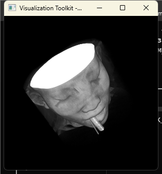

# Компьютерная графика (ННГУ)

Лабораторные работы по курсу компьютерной графики на C++ с библиотеками [VTK](https://vtk.org) (визуализация) и [ITK](https://itk.org) (обработка медицинских изображений).

| Лабораторная | Что сделано |
|---|---|
| [lab_1_itk+vtk](lab_1_itk+vtk/README.md) | сборка VTK и ITK; КТ-снимки (DICOM) читаются в ITK, обрабатываются 4 фильтрами (медиана, порог, морфология, крупнейший объект) и показываются в 3D через VTK |

## Структура репозитория

```
CompGraph/
├── README.md                 ← этот файл: окружение и сборка библиотек
└── lab_1_itk+vtk/
    ├── README.md             ← описание лабораторной, запуск, результаты
    ├── CMakeLists.txt
    ├── main.cpp              ← весь код лабораторной
    ├── utf8.manifest         ← поддержка путей с кириллицей
    ├── data/ct/              ← DICOM-серия (КТ грудной клетки, 133 среза)
    └── screenshots/          ← результаты запуска
```

Библиотеки в репозиторий не входят. Они собираются один раз в `D:\CompGraph\libs` (см. ниже).

## Окружение

| Что | Версия | Зачем |
|---|---|---|
| Windows | 10/11 x64 | |
| Visual Studio 2022 Community | компонент «Разработка классических приложений на C++» | компилятор MSVC |
| CMake | ≥ 3.21 | сборка |
| Git | любая | скачать исходники |
| CLion | 2024.1 (необязательно) | IDE |

## Сборка библиотек (один раз, ~1 час)

Всё собирается в `D:\CompGraph\libs`. Путь к библиотекам не должен содержать кириллицу и пробелы, иначе возможны ошибки сборки. Собирается только **Release**.

Итоговая структура:
```
D:\CompGraph\libs\
├── vtk-src\  vtk-build\      VTK 9.3.1
├── itk-src\  itk-build\      ITK 5.4.0 (с модулем ITKVtkGlue)
└── VTK_tutorial\             примеры FenixFly для проверки VTK
```

### 1. VTK 9.3.1 (~30–40 мин)

```powershell
git clone --depth 1 --branch v9.3.1 https://gitlab.kitware.com/vtk/vtk.git D:\CompGraph\libs\vtk-src
cmake -S D:\CompGraph\libs\vtk-src -B D:\CompGraph\libs\vtk-build -G "Visual Studio 17 2022" -A x64 -DBUILD_SHARED_LIBS=ON -DVTK_BUILD_TESTING=OFF
cmake --build D:\CompGraph\libs\vtk-build --config Release --parallel
```

Результат: около 150 DLL в `D:\CompGraph\libs\vtk-build\bin\Release`.

### 2. Проверка VTK на примерах ([FenixFly/VTK_tutorial](https://github.com/FenixFly/VTK_tutorial))

```powershell
git clone https://github.com/FenixFly/VTK_tutorial.git D:\CompGraph\libs\VTK_tutorial
```

Примеры написаны под VTK 8. Чтобы они собрались с VTK 9, в `D:\CompGraph\libs\VTK_tutorial\CMakeLists.txt` нужно:
1. удалить строку `include(${VTK_USE_FILE})`: в VTK 9 этой переменной нет, и CMake падает;
2. добавить в конец файла:
   ```cmake
   get_directory_property(targets BUILDSYSTEM_TARGETS)
   vtk_module_autoinit(TARGETS ${targets} MODULES ${VTK_LIBRARIES})
   ```
   Без этого собранные программы падают при запуске, например `VolumeRender` выдаёт `no override found for 'vtkRayCastImageDisplayHelper'`.

```powershell
cmake -S D:\CompGraph\libs\VTK_tutorial -B D:\CompGraph\libs\VTK_tutorial\build -G "Visual Studio 17 2022" -A x64 -DVTK_DIR=D:/CompGraph/libs/vtk-build
cmake --build D:\CompGraph\libs\VTK_tutorial\build --config Release --parallel

$env:PATH = "D:\CompGraph\libs\vtk-build\bin\Release;$env:PATH"
D:\CompGraph\libs\VTK_tutorial\build\Release\VolumeRender.exe D:\CompGraph\libs\VTK_tutorial\data\head.vti
```

Должно открыться окно с объёмным рендерингом головы. Всего собирается 21 пример.



### 3. ITK 5.4.0 с модулем ITKVtkGlue (~30 мин)

Модуль `ITKVtkGlue` содержит `itk::ImageToVTKImageFilter`, который передаёт изображения из ITK в VTK. По умолчанию модуль выключен, и ему нужен путь к уже собранной VTK.

```powershell
git clone --depth 1 --branch v5.4.0 https://github.com/InsightSoftwareConsortium/ITK.git D:\CompGraph\libs\itk-src
cmake -S D:\CompGraph\libs\itk-src -B D:\CompGraph\libs\itk-build -G "Visual Studio 17 2022" -A x64 -DModule_ITKVtkGlue=ON -DVTK_DIR=D:/CompGraph/libs/vtk-build -DBUILD_TESTING=OFF -DBUILD_EXAMPLES=OFF
cmake --build D:\CompGraph\libs\itk-build --config Release --parallel
```

ITK собирается статически, поэтому при запуске программ нужны только DLL VTK.

> Папки `*-build` нельзя перемещать: CMake прописывает в них абсолютные пути. Если библиотеки нужны в другом месте, их придётся пересобрать.

## Сборка и запуск лабораторной

### Из консоли

```powershell
cd lab_1_itk+vtk
cmake -S . -B build -G "Visual Studio 17 2022" -A x64
cmake --build build --config Release
build\Release\itk_vtk.exe data\ct
```

`CMakeLists.txt` по умолчанию ищет библиотеки в `D:/CompGraph/libs`. Другой путь задаётся так: `-DLIBS_DIR=E:/my/libs`. После сборки DLL VTK копируются рядом с `itk_vtk.exe`, поэтому `PATH` настраивать не нужно.

### В CLion

1. Открыть папку `lab_1_itk+vtk`.
2. **Settings → Build, Execution, Deployment → Toolchains**: тулчейн `Visual Studio` с архитектурой `amd64`.
3. **Settings → Build, Execution, Deployment → CMake**: добавить профиль **Release** (кнопка `+`) и выбрать его. В профиле `Debug` проект не соберётся: библиотеки собраны в Release, а MSVC не позволяет смешивать Debug- и Release-библиотеки (ошибка `LNK2038 mismatch detected`).
4. **Run → Edit Configurations → itk_vtk**:
   - Program arguments: `data\ct 4`
   - Working directory: `$ProjectFileDir$`
5. Запустить `itk_vtk`.

Описание аргументов, фильтров и результатов: в [README лабораторной](lab_1_itk+vtk/README.md).

## Частые проблемы

| Симптом | Причина и решение |
|---|---|
| `Could not find a package configuration file provided by "ITK"` | библиотеки не собраны или лежат не в `D:/CompGraph/libs`; укажите `-DLIBS_DIR=...` |
| `LNK2038: mismatch detected for '_ITERATOR_DEBUG_LEVEL'` | сборка в Debug; нужен Release |
| программа не стартует, `vtk*.dll не найден` | пересоберите проект (DLL копируются после сборки) или добавьте `D:\CompGraph\libs\vtk-build\bin\Release` в `PATH` |
| `... is not a directory`, `No DICOM series` | неверный путь к данным; запускайте из папки лабораторной или укажите полный путь |
| `no override found for 'vtk...'` | в `CMakeLists.txt` нет `vtk_module_autoinit` |
