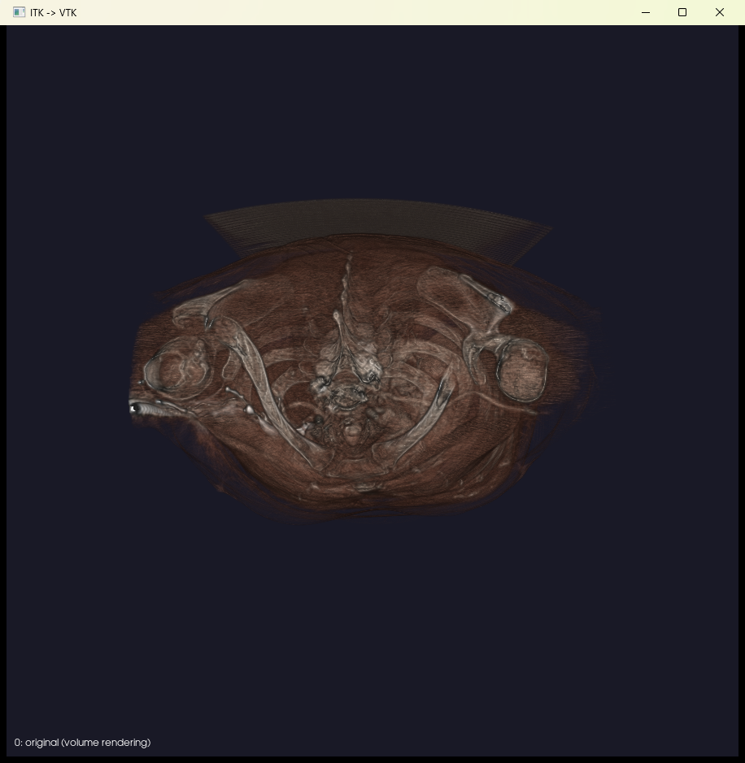
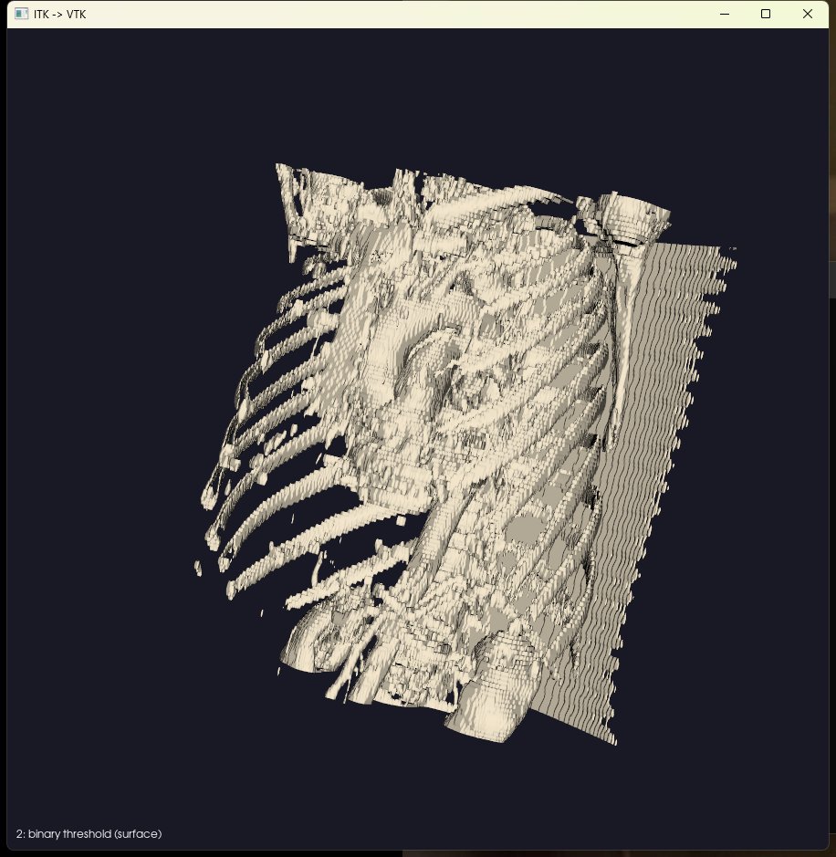
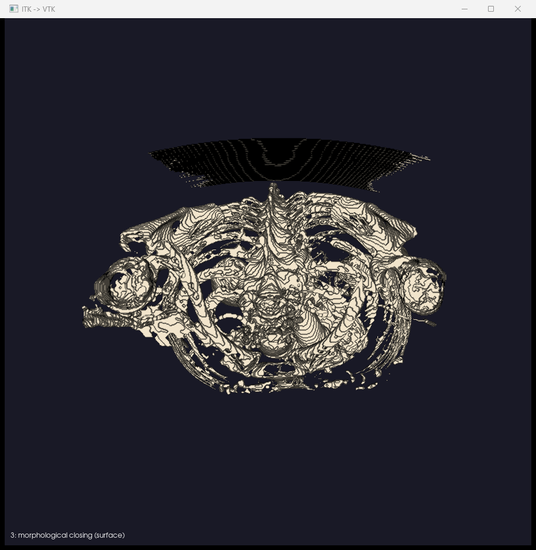
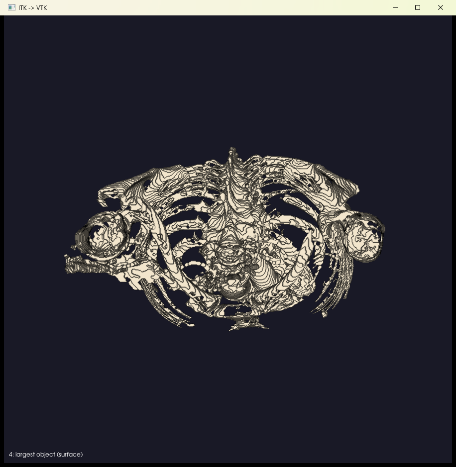

# Лабораторная 1: ITK + VTK

**Задание:**
1. Собрать VTK, проверить сборку на примерах.
2. Загрузить 3D-данные в ITK, обработать их фильтрами, передать в VTK и визуализировать с возможностью вращения.

Сборка VTK и ITK и проверка на примерах FenixFly описаны в [корневом README](../README.md). Здесь только вторая часть.

## Данные

КТ грудной клетки из открытого архива [TCIA, коллекция LIDC-IDRI](https://doi.org/10.7937/K9/TCIA.2015.LO9QL9SX), пациент LIDC-IDRI-0001. Это 133 DICOM-среза 512×512, значения в единицах Хаунсфилда (HU), лицензия CC BY 3.0 (`data/ct/LICENSE`).

Скачать заново:
```bash
curl -o ct.zip "https://services.cancerimagingarchive.net/nbia-api/services/v1/getImage?SeriesInstanceUID=1.3.6.1.4.1.14519.5.2.1.6279.6001.179049373636438705059720603192"
unzip ct.zip -d data/ct
```

## Как работает программа (`main.cpp`)

```
DICOM-срезы ──ITK──> 3D-изображение (HU) ──фильтры ITK──> ImageToVTKImageFilter ──VTK──> окно 3D
```

1. **Чтение**: `itk::GDCMSeriesFileNames` находит срезы серии в папке, `itk::ImageSeriesReader` + `itk::GDCMImageIO` собирают их в 3D-изображение `itk::Image<short, 3>`.
2. **Обработка**: цепочка из 4 фильтров ITK выделяет скелет. Каждая стадия работает с результатом предыдущей.
3. **Передача в VTK**: `itk::ImageToVTKImageFilter` (модуль `ITKVtkGlue`) превращает `itk::Image` в `vtkImageData`.
4. **Визуализация**: КТ-данные показываются объёмным рендерингом (`vtkSmartVolumeMapper` с передаточными функциями в HU), бинарные маски показываются поверхностью (`vtkFlyingEdges3D`).

| Стадия | Фильтр ITK | Что делает | Отображение в VTK |
|---|---|---|---|
| 0 | — | исходные данные | объёмный рендеринг |
| 1 | `MedianImageFilter` (окно 3×3×3) | убирает шум, сохраняя границы | объёмный рендеринг |
| 2 | `BinaryThresholdImageFilter` | маска кости: HU от порога (по умолчанию 200) до 3071 | поверхность |
| 3 | `BinaryMorphologicalClosingImageFilter` (шар радиуса 1) | морфологическое закрытие, заделывает мелкие дыры в кости | поверхность |
| 4 | `BinaryShapeKeepNObjectsImageFilter` | оставляет крупнейшую связную область (скелет), убирает стол томографа и шум | поверхность |

## Сборка

```powershell
cmake -S . -B build -G "Visual Studio 17 2022" -A x64
cmake --build build --config Release
```

Если библиотеки лежат не в `D:/CompGraph/libs`, добавьте `-DLIBS_DIR=<путь>`. Настройка CLion описана в [корневом README](../README.md#в-clion).

## Запуск

```
itk_vtk <папка_DICOM> [стадия 0..4] [порог_кости_HU]
```

Из папки лабораторной:
```powershell
build\Release\itk_vtk.exe data\ct          # стадия 4 (по умолчанию): скелет
build\Release\itk_vtk.exe data\ct 0        # исходные данные
build\Release\itk_vtk.exe data\ct 1        # после медианного фильтра
build\Release\itk_vtk.exe data\ct 2 400    # маска кости с порогом 400 HU (только плотная кость)
```

**Управление в окне:** ЛКМ вращает, колесо масштабирует, Shift+ЛКМ сдвигает, `r` сбрасывает камеру, `q` закрывает окно.

Путь к данным может содержать кириллицу: `utf8.manifest` переключает программу на UTF-8. Без него ITK не открывает папки вида `D:\ННГУ\...`.

## Результаты

| 0: исходные данные | 2: порог 200 HU |
|---|---|
|  |  |
| **3: закрытие** (стол томографа ещё виден сверху) | **4: крупнейший объект** (остался только скелет) |
|  |  |
