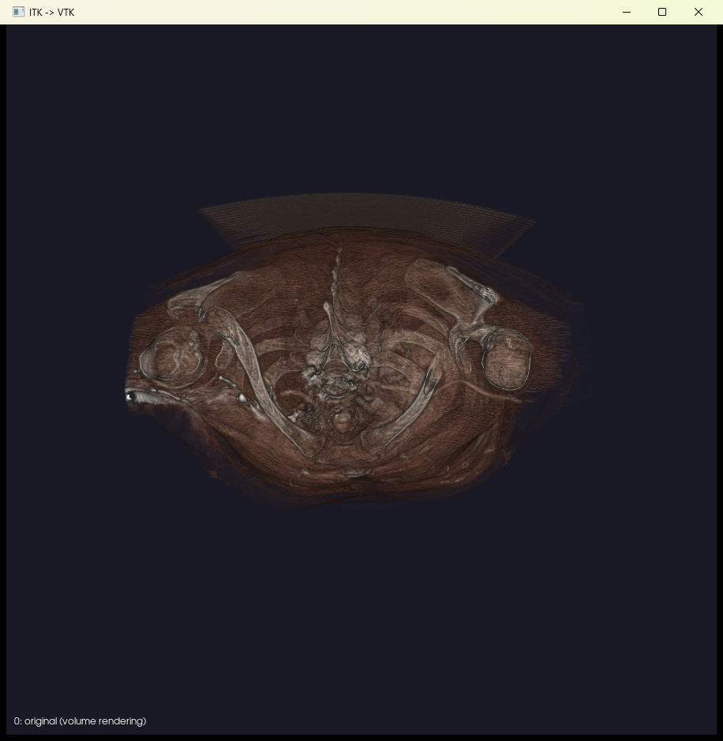
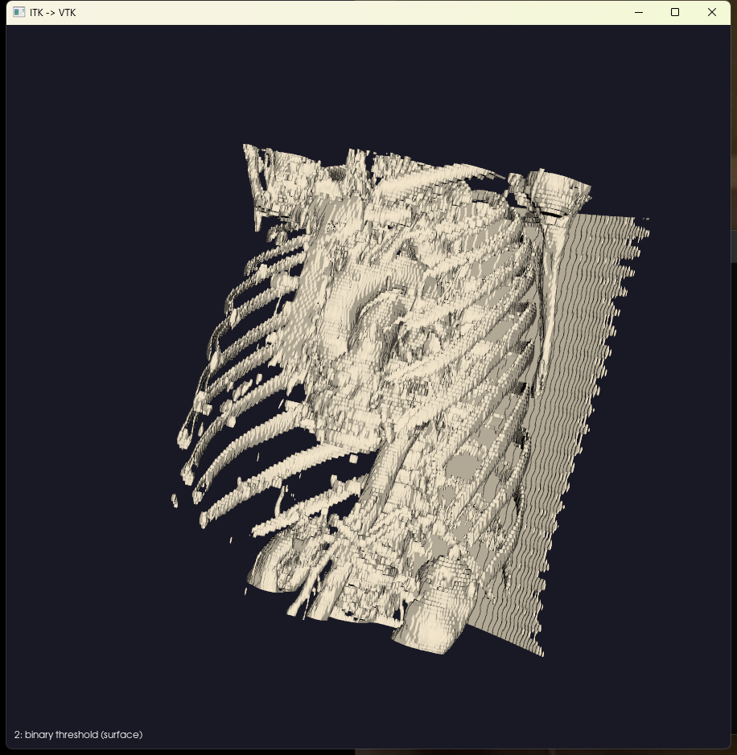
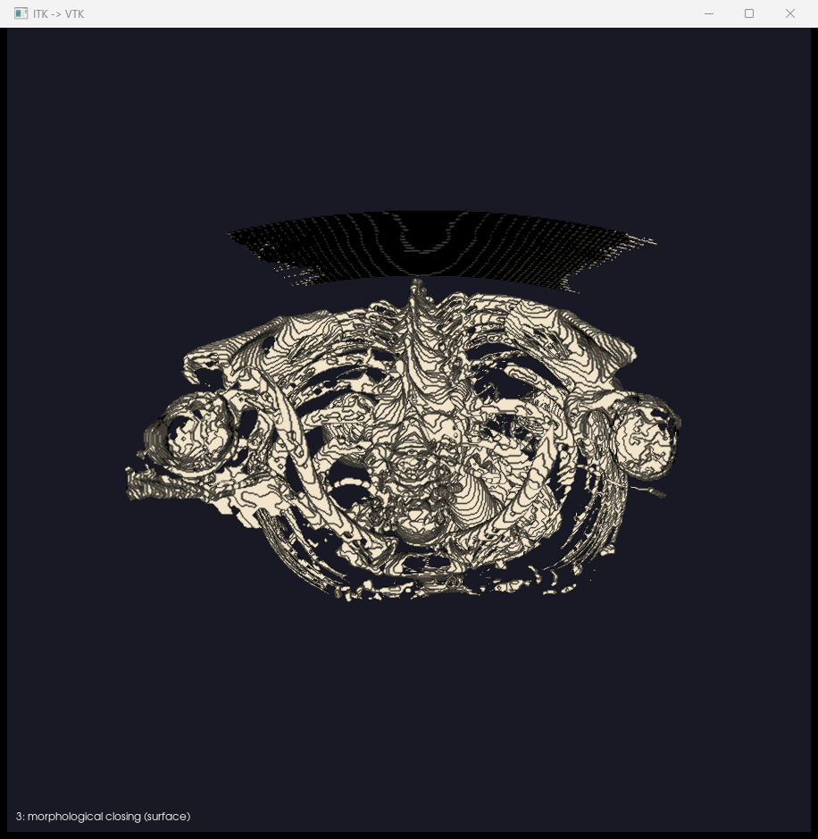
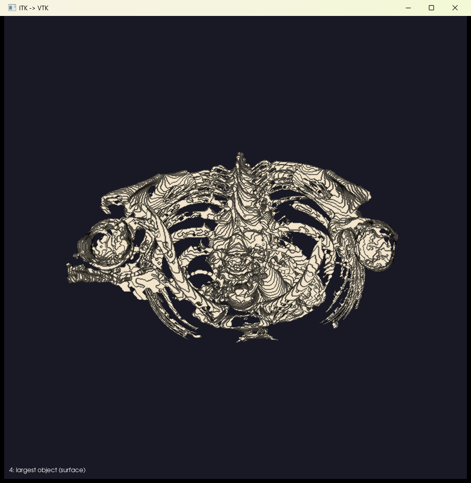

# Лабораторная 1: ITK + VTK

**Задание:**
1. Собрать VTK, проверить сборку на примерах.
2. Загрузить 3D-данные в ITK, обработать их фильтрами, передать в VTK и визуализировать с возможностью вращения.

Сборка VTK и ITK и проверка на примерах FenixFly описаны в [корневом README](../README.md). Здесь только вторая часть.

## Данные

КТ грудной клетки из открытого архива [TCIA, коллекция LIDC-IDRI](https://doi.org/10.7937/K9/TCIA.2015.LO9QL9SX), пациент LIDC-IDRI-0001. Это 133 DICOM-среза 512×512, значения в единицах Хаунсфилда (HU), лицензия CC BY 3.0 (`data/ct/LICENSE`).

Скачать заново:
```bash
curl -o ct.zip "https://services.cancerimagingarchive.net/nbia-api/services/v1/getImage?SeriesInstanceUID=1.3.6.1.4.1.14519.5.2.1.6279.6001.179049373636438705059720603192"
unzip ct.zip -d data/ct
```

### Шкала Хаунсфилда

Значение каждого вокселя КТ показывает плотность ткани в единицах Хаунсфилда (HU). Шкала привязана к воде (0 HU) и воздуху (−1000 HU), поэтому одна и та же ткань имеет примерно одинаковые значения на любом томографе. На этом построена вся обработка: кость отделяется от остального простым порогом.

| Ткань | HU |
|---|---|
| воздух | −1000 |
| лёгкие | −900…−500 |
| жир | около −100 |
| вода | 0 |
| мягкие ткани, мышцы | +20…+80 |
| кость | +200…+3000 |

## Как работает программа (`main.cpp`)

```
DICOM-срезы ─► ImageSeriesReader ─► Median ─► Threshold ─► Closing ─► KeepLargest
                     │ (стадия 0)    │ (1)       │ (2)         │ (3)       │ (4)
                     └──────┬────────┘           └─────────────┴───────────┘
                    объёмный рендеринг          поверхность (FlyingEdges3D)
                            └──────── ImageToVTKImageFilter ────────┘
                                              ▼
                                      окно VTK с вращением
```

Работу делят две библиотеки: **ITK** читает и обрабатывает медицинские изображения, **VTK** рисует 3D-сцену. Мост между ними — модуль `ITKVtkGlue`, поэтому ITK собирается с `-DModule_ITKVtkGlue=ON`.

Кратко по стадиям:

| Стадия | Фильтр ITK | Что делает | Отображение в VTK |
|---|---|---|---|
| 0 | — | исходные данные | объёмный рендеринг |
| 1 | `MedianImageFilter` (окно 3×3×3) | убирает шум, сохраняя границы | объёмный рендеринг |
| 2 | `BinaryThresholdImageFilter` | маска кости: HU от порога (по умолчанию 200) до 3071 | поверхность |
| 3 | `BinaryMorphologicalClosingImageFilter` (шар радиуса 1) | морфологическое закрытие, заделывает мелкие дыры в кости | поверхность |
| 4 | `BinaryShapeKeepNObjectsImageFilter` | оставляет крупнейшую связную область (скелет), убирает стол томографа и шум | поверхность |

### 1. Чтение DICOM

- `itk::GDCMSeriesFileNames` просматривает папку и группирует файлы по серии (`SeriesInstanceUID`). Срезы сортируются по положению в пространстве из метаданных DICOM, а не по имени файла.
- `itk::ImageSeriesReader` с `itk::GDCMImageIO` склеивает срезы в один объём `itk::Image<short, 3>` размером 512×512×133. Тип `short` выбран потому, что HU — знаковые целые примерно от −1024 до 3071.
- Размер вокселя (spacing) и положение объёма тоже берутся из DICOM. Расстояние между срезами больше размера пикселя в срезе, и без spacing модель получилась бы сплющенной.

### 2. Конвейер фильтров ITK

Фильтры соединяются в цепочку: `filter->SetInput(previous->GetOutput())`. Конвейер **ленивый**: при создании фильтров ничего не считается. Расчёт запускает только `Update()` у выхода нужной стадии, и ITK выполняет лишь те фильтры, что стоят перед ней. Поэтому стадия 0 не тратит время на фильтрацию.

#### Стадия 1. Медианный фильтр — `itk::MedianImageFilter`

- **Параметр:** `SetRadius(1)`, то есть окно 3×3×3 = 27 вокселей.
- **Как работает:** каждый воксель заменяется медианой значений в окне вокруг него.
- **Зачем:** убирает шум КТ, в первую очередь одиночные выбросы («соль и перец»). В отличие от размытия по Гауссу, медиана почти не размывает резкие границы, например между костью и мягкими тканями. Это важно для следующего шага: порог по зашумлённым данным даёт рваную маску.
- **Результат:** изображение по-прежнему в HU, поэтому оно показывается так же, как исходное, объёмным рендерингом.

#### Стадия 2. Бинарный порог — `itk::BinaryThresholdImageFilter`

- **Параметры:** нижний порог — третий аргумент программы (по умолчанию 200 HU), верхний — 3071 HU (максимум шкалы); `InsideValue = 1`, `OutsideValue = 0`.
- **Как работает:** воксель со значением в [порог, 3071] становится 1, остальные — 0. Выход уже другого типа: маска `itk::Image<unsigned char, 3>`.
- **Зачем:** отделяет кость от всего остального. Ниже 200 HU лежат мягкие ткани, жир, лёгкие и воздух.
- **Побочный эффект:** в маску попадает всё плотное — контрастированные сосуды, кальцинаты и стол томографа. С порогом 400 HU (`... 2 400`) остаётся только плотная кость, но в губчатой кости появляются дыры.

#### Стадия 3. Морфологическое закрытие — `itk::BinaryMorphologicalClosingImageFilter`

- **Параметры:** структурный элемент — шар радиуса 1 (`itk::BinaryBallStructuringElement`), значение объекта `ForegroundValue = 1`.
- **Как работает:** закрытие — это дилатация (маска расширяется на радиус шара), а затем эрозия (сужается обратно). Объект в целом остаётся прежнего размера, но щели и дыры уже шара успевают зарасти при дилатации и не открываются при эрозии.
- **Зачем:** губчатая кость пористая, после порога её маска дырявая. Закрытие делает поверхность сплошной и склеивает близко лежащие фрагменты.
- **Ограничение:** стол томографа никуда не девается, он виден на скриншоте стадии 3.

#### Стадия 4. Крупнейший объект — `itk::BinaryShapeKeepNObjectsImageFilter`

- **Параметры:** `SetNumberOfObjects(1)`, `SetAttribute("NumberOfPixels")`.
- **Как работает:** фильтр делит маску на связные области (соседние воксели со значением 1 образуют одну область), считает размер каждой в вокселях и оставляет одну, самую большую.
- **Зачем:** рёбра, позвоночник, грудина и лопатки после закрытия образуют одну большую связную область, а стол томографа и шумовые точки лежат отдельно и меньше по объёму. В результате остаётся только скелет.

### 3. Передача в VTK — `itk::ImageToVTKImageFilter`

Функция `ToVtk` превращает `itk::Image` в `vtkImageData` с теми же размерами, spacing и началом координат. Результат копируется через `DeepCopy`: выход коннектора живёт, только пока жив сам коннектор, а это локальная переменная функции. Функция шаблонная и работает и для КТ (`short`), и для маски (`unsigned char`).

### 4. Визуализация

**Стадии 0–1 — объёмный рендеринг** (`MakeVolume`). Изображение ещё в HU, поэтому показывается весь объём методом ray casting: через каждый пиксель экрана проходит луч, и вдоль него накапливаются цвет и прозрачность вокселей.
- `vtkSmartVolumeMapper` сам выбирает реализацию: на видеокарте или на процессоре.
- Прозрачность (`vtkPiecewiseFunction`) зависит от HU: до −100 (воздух, лёгкие, жир) воксели полностью прозрачны, мягкие ткани (около 50) почти прозрачны (0.05), кость постепенно становится плотной (0.15 при 300, 0.8 при 1200). Поэтому сквозь тело видны рёбра и позвоночник.
- Цвет (`vtkColorTransferFunction`): чёрный → телесный (0 HU) → кремовый (300) → белый (1200).
- `ShadeOn()` включает освещение по градиенту, объём выглядит рельефным.

**Стадии 2–4 — поверхность** (`MakeSurface`). У маски только два значения, 0 и 1, поэтому строится изоповерхность:
- `vtkFlyingEdges3D` (быстрый параллельный аналог Marching Cubes) находит, где значение пересекает 0.5, то есть границу между 0 и 1, и строит по ней сетку из треугольников;
- `vtkPolyDataMapper` и `vtkActor` выводят сетку обычной полигональной графикой кремового цвета.

**Окно.** `vtkRenderer` (сцена), `vtkRenderWindow` (окно 900×900) и `vtkRenderWindowInteractor` (мышь и клавиатура, стиль trackball camera). Слева внизу `vtkTextActor` подписывает текущую стадию, `ResetCamera()` выставляет камеру так, чтобы объект поместился целиком.

### Остальные файлы

- `CMakeLists.txt` ищет ITK и VTK в `LIBS_DIR`, вызывает `vtk_module_autoinit` (без него VTK 9 падает при запуске с `no override found for 'vtk...'`) и после сборки копирует DLL VTK к `itk_vtk.exe`.
- `utf8.manifest` вшивается в exe и переключает его кодовую страницу на UTF-8, чтобы ITK открывал пути с кириллицей.

## Сборка

```powershell
cmake -S . -B build -G "Visual Studio 17 2022" -A x64
cmake --build build --config Release
```

Если библиотеки лежат не в `D:/CompGraph/libs`, добавьте `-DLIBS_DIR=<путь>`. Настройка CLion описана в [корневом README](../README.md#в-clion).

## Запуск

```
itk_vtk <папка_DICOM> [стадия 0..4] [порог_кости_HU]
```

Из папки лабораторной:
```powershell
build\Release\itk_vtk.exe data\ct          # стадия 4 (по умолчанию): скелет
build\Release\itk_vtk.exe data\ct 0        # исходные данные
build\Release\itk_vtk.exe data\ct 1        # после медианного фильтра
build\Release\itk_vtk.exe data\ct 2 400    # маска кости с порогом 400 HU (только плотная кость)
```

Или из корня репозитория одной командой (сборка и запуск): `.\run_lab1.bat 2 400`, см. [корневой README](../README.md#батником-run_lab1bat).

**Управление в окне:** ЛКМ вращает, колесо масштабирует, Shift+ЛКМ сдвигает, `r` сбрасывает камеру, `q` закрывает окно.

Путь к данным может содержать кириллицу: `utf8.manifest` переключает программу на UTF-8. Без него ITK не открывает папки вида `D:\ННГУ\...`.

## Результаты

| 0: исходные данные | 2: порог 200 HU |
|---|---|
|  |  |
| **3: закрытие** (стол томографа ещё виден сверху) | **4: крупнейший объект** (остался только скелет) |
|  |  |
